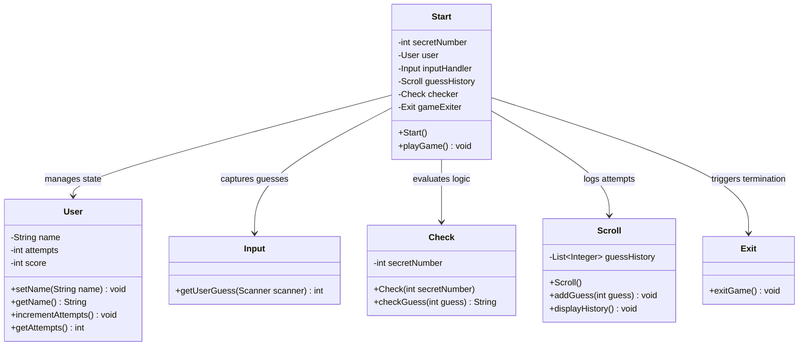

<div align="center">


[](https://www.java.com/)
[](#)
[](#)
[](#)

</div>

---

## 📌 Executive Summary / Overview

The **Interactive Number Guessing Game** (`Random-Guessing-Number`) is a modular, console-based Java application built in strict adherence to the **Single Responsibility Principle (SRP)** of the SOLID software design paradigm. Rather than bundling game logic, input parsing, history tracking, and termination into a single monolithic script, this project decomposes the system into six distinct, cohesive classes.

The game generates a cryptographically pseudorandom integer within the closed interval $[1, 100]$. The player is provided dynamic directional feedback ("Too high", "Too low", or "Correct") on each guess, while an automated tracking scroll captures historical attempts to assist heuristic convergence.

---

## 📖 Interactive Table of Contents

- [Executive Summary / Overview](#-executive-summary--overview)
- [Key Features & Capabilities](#-key-features--capabilities)
- [System Architecture & Class Collaboration](#-system-architecture--class-collaboration)
- [Tech Stack Breakdown](#-tech-stack-breakdown)
- [Single Responsibility Decomposition](#-single-responsibility-decomposition)
- [Reproducible Quickstart & Setup](#-reproducible-quickstart--setup)
- [Project Directory Layout](#-project-directory-layout)
- [Author & Contributions](#-author--contributions)

---

## ✨ Key Features & Capabilities

- **Strict SOLID / SRP Decoupling**: Separate dedicated classes for player state (`User`), input sanitization (`Input`), numeric evaluation (`Check`), attempt logging (`Scroll`), game orchestration (`Start`), and termination (`Exit`).
- **Dynamic Binary Search Feedback**: Outputs directional hints guiding the player towards logarithmic $O(\log N)$ convergence.
- **Persistent Guess History Tracker**: The `Scroll` module maintains an append-only `List<Integer>` tracking past guesses, displaying the sequence after every turn.
- **Graceful Lifecycle Control**: Handles input stream cleanup, session resets, and structured program exit via the `Exit` class.
- **Player Profiling & Metrics**: Records player identity and dynamically increments attempt counters to measure heuristic efficiency upon victory.

---

## 🏗️ System Architecture & Class Collaboration



---

## 🛠️ Tech Stack Breakdown

| Category | Technologies & Tools |
| :--- | :--- |
| **Language** | Java (JDK 11, 17, 21) |
| **Design Paradigm** | Object-Oriented Programming (OOP), SOLID Single Responsibility |
| **Collections** | `java.util.ArrayList<Integer>`, `java.util.List` |
| **Utilities** | `java.util.Random`, `java.util.Scanner` |
| **Platform** | Cross-platform Console / Terminal (Windows, Linux, macOS) |

---

## 🧩 Single Responsibility Decomposition

| Class File | Primary Responsibility | Key Methods |
| :--- | :--- | :--- |
| `Start.java` | Coordinates the game loop, instantiates dependencies, controls flow | `playGame()`, `main()` |
| `User.java` | Encapsulates player state, name, and total attempt count | `setName()`, `incrementAttempts()` |
| `Input.java` | Sanitizes and parses integer inputs from the console stream | `getUserGuess(Scanner)` |
| `Check.java` | Evaluates proximity of guess to secret target ($<, >, ==$) | `checkGuess(int)` |
| `Scroll.java` | Tracks historical list of user guesses and renders history log | `addGuess(int)`, `displayHistory()` |
| `Exit.java` | Manages graceful system exit and farewell prompts | `exitGame()` |

---

## 🚀 Reproducible Quickstart & Setup

### Prerequisites
- JDK 11+ installed

### Step 1: Clone the Repository
```bash
git clone https://github.com/Jeshwanthika07/Random-Guessing-Number.git
cd Random-Guessing-Number
```

### Step 2: Compile All Class Modules
```bash
javac *.java
```

### Step 3: Launch the Game
```bash
java Start
```

### Sample Interactive Gameplay Session:
```text
Welcome to the Random Guessing Game!
Enter your name: Jeshwanthika
Hello, Jeshwanthika! Try to guess the number between 1 and 100.
Enter your guess: 50
Too high! Try a lower number.
Guess History: [50]
Do you want to continue? (yes/no): yes
Enter your guess: 25
Too low! Try a higher number.
Guess History: [50, 25]
Do you want to continue? (yes/no): yes
Enter your guess: 37
Congratulations! You guessed the correct number.
You guessed it in 3 attempts.
```

---

## 📂 Project Directory Layout

```text
Random-Guessing-Number/
│
├── Start.java                 # Central game orchestrator & primary execution loop
├── User.java                  # Player profile entity & attempt counter
├── Input.java                 # Standard input scanner & parser
├── Check.java                 # Comparator evaluating guess proximity
├── Scroll.java                # Attempt history collection & visualization
├── Exit.java                  # Graceful program termination handler
├── Main.java                  # Standalone entry point harness
└── README.md                  # Comprehensive architectural documentation
```

---

## 👩‍💻 Author & Contributions

Authored by **[Jeshwanthika Pothamchetty](https://github.com/Jeshwanthika07)**  
*Alliance University | Department of Computer Applications*

<div align="center">


</div>
